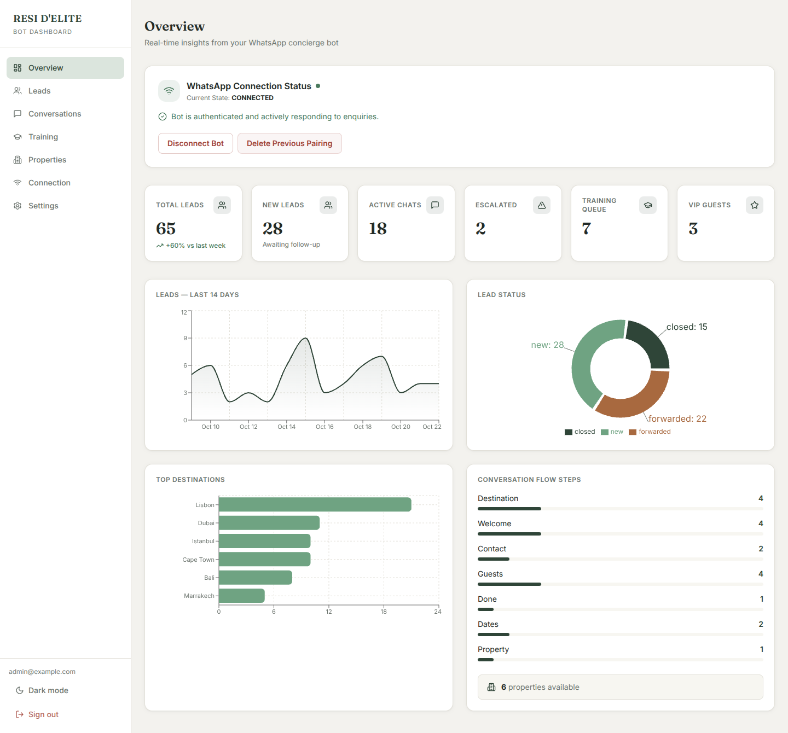
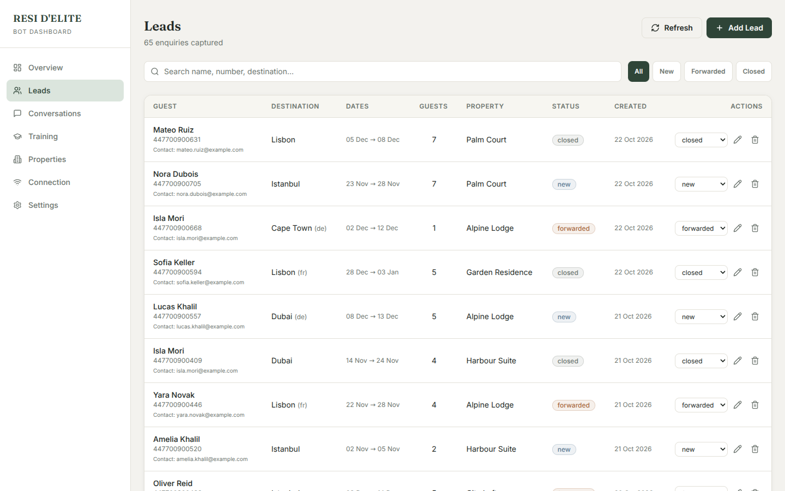
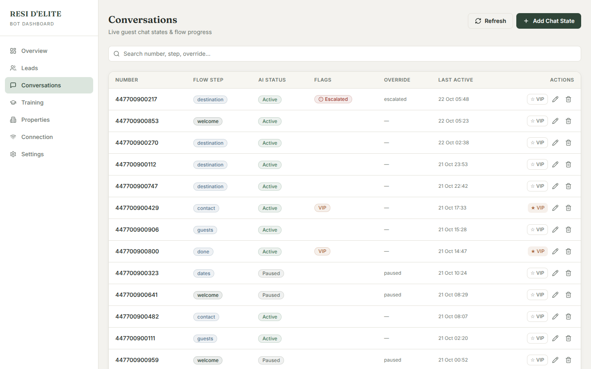
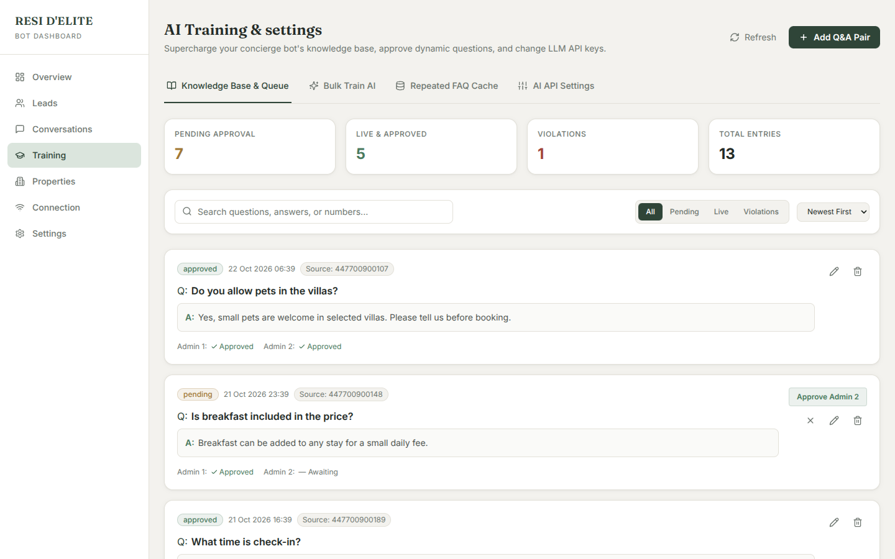
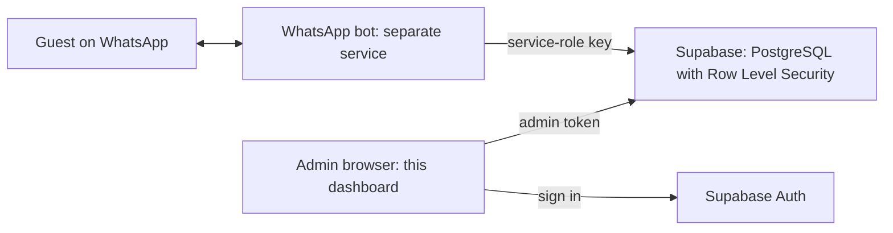

<div align="center">

<h1>RESI D'ELITE Admin Dashboard</h1>

<p><strong>An admin dashboard for a WhatsApp booking bot: manage leads, conversations, AI training, properties, and the bot's WhatsApp connection from one place.</strong></p>

<p>
  <a href="https://github.com/hamzabhulla/WhatsApp-Concierge-ResideElite"><strong>Source Code</strong></a>
  &nbsp;·&nbsp;
  <a href="docs/ENGINEERING.md">Engineering Notes</a>
  &nbsp;·&nbsp;
  <a href="docs/SECURITY.md">Security Model</a>
  &nbsp;·&nbsp;
  <a href="#getting-started">Getting Started</a>
</p>

<p>
  
  
  <a href="https://github.com/hamzabhulla/WhatsApp-Concierge-ResideElite/actions/workflows/ci.yml"></a>
  <a href="LICENSE"></a>
</p>

</div>

<p align="center"></p>

| Leads | Conversations | Training (two-admin approval) |
| --- | --- | --- |
|  |  |  |

<p align="center"><sub>Screenshots use fictional demo data.</sub></p>

## Overview

The dashboard is the control panel for a WhatsApp booking bot (a separate service, `resi-bot`). The bot captures booking enquiries and keeps each guest's conversation state in Supabase; the dashboard reads and edits that same data. There is no separate backend: the React app talks directly to your Supabase project, and access is enforced by the database.

| Page | What you do there |
| --- | --- |
| **Overview** | Live numbers and charts: leads, status split, top destinations, conversation steps, and WhatsApp link status |
| **Leads** | Search, filter, add, edit, and close booking enquiries captured by the bot |
| **Conversations** | See each guest's chat state, pause or resume the AI per guest, mark VIPs, and resolve escalations |
| **Training** | Review questions the bot couldn't answer, approve answers (two-admin approval), bulk-train, and manage AI API keys |
| **Properties** | Manage the property catalogue the bot recommends from (availability, prices, guest limits) |
| **Connection** | Link the bot's WhatsApp number (QR code or pairing code), disconnect, or wipe the session |
| **Settings** | AI provider and API keys, and the lead-forwarding number |

## Architecture



- **The bot writes, the dashboard reviews.** The bot stores leads, conversation state, and questions it couldn't answer; the dashboard lets admins act on them and manages the properties, settings, and AI keys the bot reads.
- **Access control lives in the database.** Row Level Security allows only users whose token carries `app_metadata.role = "admin"`. The bot connects with the service-role key and is unaffected.
- **The dashboard controls the bot through a table.** It writes commands (`CONNECT`, `DISCONNECT`, `PAIR`, `WIPE_SESSION`) to `whatsapp_connection` and reads back status and the login QR.
- **Static frontend.** The app builds to static files (React 18, Vite, Tailwind CSS) and runs on any static host.

## Engineering decisions

Five decisions shaped the dashboard. Each is summarized here; the longer write-up is in [docs/ENGINEERING.md](docs/ENGINEERING.md).

### 1. Authorization enforced by the database
- **Challenge:** a browser app can't be trusted to hide data, and the public anon key ships in its JavaScript.
- **Solution:** Row Level Security on every table, one admin-only policy per table, and no table privileges for the `anon` role. The admin role is stored in `app_metadata`, which users cannot edit (unlike `user_metadata`). The UI shows "Access denied" to non-admins as a convenience, not as the protection.
- **Trade-off:** a new admin's role appears only in a new token, so they must press **Check again** or sign in again, and admins are managed with SQL.

### 2. Keeping secrets out of the browser
- **Challenge:** everything with a `VITE_` prefix is public, and settings pages tend to attract secrets.
- **Solution:** only the Supabase URL and anon key are configured in the app. Saving API keys or the forwarding number re-checks the admin's real login password with Supabase, and the app shows a clear "not configured" screen instead of a blank page when settings are missing.
- **Trade-off:** API keys are stored in an admin-only table and are visible to admins on the Settings page, so only trusted people should be made admins.

### 3. Controlling a bot through the database
- **Challenge:** link and manage a WhatsApp session remotely, without running a server of its own.
- **Solution:** a single-row command table that the dashboard writes and the bot reads. The dashboard polls status every 3 seconds, only while the tab is visible, and draws the login QR in the browser with a local library, so the QR that links the account is never sent to a third-party service.
- **Trade-off:** polling is simple but not instant, and the bot has to be running to act on commands.

### 4. Reliable data handling
- **Challenge:** list views looked correct while quietly showing wrong data.
- **Solution:** requests are latest-wins, so a slow older response can't overwrite a newer one. Totals page through results past the API's silent 1,000-row cap. Database timestamps are read as UTC, search text is sanitized before it reaches a filter string, and errors are shown with a suggested fix instead of an empty page.
- **Trade-off:** Overview totals read rows in the browser (up to 20,000 per table), which suits thousands of leads; a database view would suit much larger data.

### 5. Resilience and a lighter first load
- **Challenge:** a single failing component shouldn't blank the whole app, and the login screen shouldn't pay for the charts library.
- **Solution:** pages are loaded on demand, an error boundary shows a reload screen on render crashes, and failed saves report the reason instead of closing the form as if they had succeeded.
- **Trade-off:** more states to design (loading, error, empty) in exchange for a calmer failure experience.

## Project facts

| Fact | Detail | Where to verify |
| --- | --- | --- |
| Automated tests | 46 passing (Vitest and Testing Library; no network or database needed), run on every push by GitHub Actions | `npm test`, `.github/workflows/ci.yml` |
| Test scope | Logic and component tests in jsdom; no end-to-end browser tests yet | `tests/` |
| Dependencies | 8 runtime, 11 development | `package.json` |
| Source size | About 3,600 lines of JavaScript and JSX | `src/` |
| Login screen load | About 120 KB of JavaScript and 6 KB of CSS, gzipped; the charts library loads with the Overview page | `npm run build` |
| Database | 7 tables, all with Row Level Security and a single admin-only policy; `anon` has no table privileges | `supabase/setup.sql` |
| Security headers | 6 headers plus a single-page-app rewrite (no Content-Security-Policy yet) | `vercel.json` |
| Dependency audit | `npm audit` on 22 Oct 2026 reported 11 advisories, all in build and test tooling (Vite, Vitest, Tailwind toolchain); none in the 8 runtime dependencies | `npm audit` |
| Third-party requests | Supabase and Google Fonts (Inter, Fraunces) | `index.html` |
| Node.js | 20 or later | `package.json` |

## Getting started

Requirements: Node.js 20 or later, a Supabase project (the free tier works), and the WhatsApp bot running against the **same** Supabase project. The full walkthrough, with verification queries, is in [docs/SETUP.md](docs/SETUP.md).

1. **Clone and install**

   ```bash
   git clone https://github.com/hamzabhulla/WhatsApp-Concierge-ResideElite.git
   cd WhatsApp-Concierge-ResideElite
   npm install
   ```

2. **Prepare Supabase.** In the SQL Editor, run `supabase/setup.sql`, then create your login under **Authentication → Users** and run `supabase/make-admin.sql` with your e-mail. Turn **off** "Allow new users to sign up".

3. **Configure the app.**

   ```bash
   cp .env.example .env
   ```

   ```ini
   VITE_SUPABASE_URL=https://your-project-ref.supabase.co
   VITE_SUPABASE_ANON_KEY=your-anon-public-key
   ```

   Use only the anon (publishable) key. Never put a service-role key, API key, or password in a `VITE_` variable.

4. **Run it.**

   ```bash
   npm run dev      # http://localhost:5173
   npm test         # 46 tests
   ```

**Deploy:** it's a static site. On Vercel, import the repository, choose the Vite preset, add the two variables, and deploy; `vercel.json` contains the rewrite and security headers. Variables are read at build time, so redeploy after changing them.

## Documentation

- [Setup guide](docs/SETUP.md): database, auth settings, configuration, deployment, and admin operations
- [Security model](docs/SECURITY.md): how data is protected, how to verify it, and known limits
- [Engineering notes](docs/ENGINEERING.md): decisions, diagrams, and trade-offs in depth
- [Troubleshooting](docs/TROUBLESHOOTING.md)

## Project structure

```text
src/
  App.jsx               routes, admin gate, lazy-loaded pages
  context/              AuthContext (session and admin flag), ThemeContext
  hooks/                data hooks: errors, latest-wins requests, paged totals
  lib/                  Supabase client, password re-check, utilities, overview stats
  components/           Layout, Sidebar, WhatsAppConnect, QrCode, ErrorBoundary, ...
  pages/                Overview, Leads, Conversations, Training, Properties,
                        Connection, Settings, Login
supabase/
  setup.sql             tables, indexes, and admin-only security (run first)
  make-admin.sql        promote a login to admin (run second)
tests/                  unit and component tests
docs/                   guides and screenshots
.github/workflows/      CI (tests and build)
```

## Limitations

- Lists don't refresh automatically; use the **Refresh** buttons (WhatsApp status polls every 3 seconds while the tab is visible).
- Overview totals are computed in the browser from up to 20,000 rows per table.
- API keys are visible to admins on the Settings page, so grant admin access carefully.

## Roadmap

- Upgrade the build and test tooling (Vite, Vitest, Tailwind) to clear the current `npm audit` advisories.
- Add a Content-Security-Policy header tuned to the Supabase domain.
- Add end-to-end browser tests against a seeded Supabase project.
- Refresh lists automatically.

## License

Released under the [MIT License](LICENSE).

## Author

Built by [Hamza Bhulla](https://github.com/hamzabhulla).
