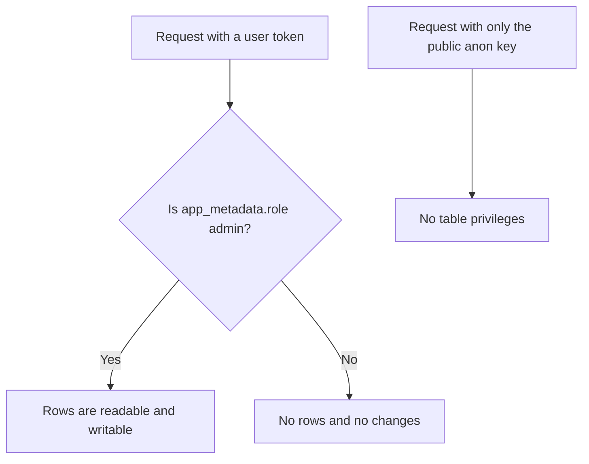
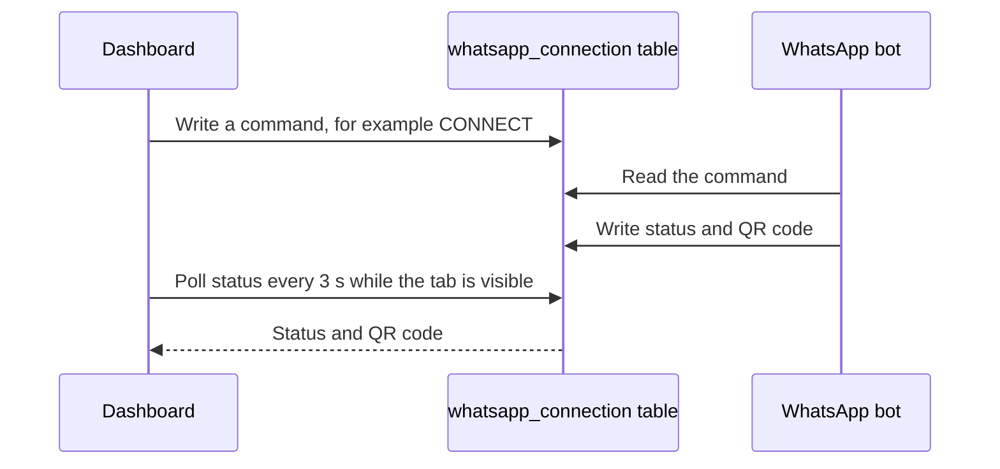
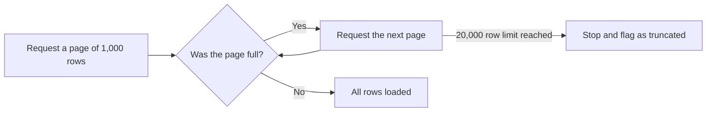

# Engineering notes

This page expands the decisions summarized in the [README](../README.md): the challenge, the solution, and the trade-off for each, with pointers to the code.

## 1. Authorization enforced by the database

**Challenge.** A browser app can't be trusted to hide data. The Supabase anon key has to ship in the JavaScript, so anything it can reach is effectively public.

**Solution.**

- Row Level Security is on for every table, with one policy per table, `dashboard_admin_all`. It allows access only when `app_metadata.role` in the user's token is `admin`.
- The role lives in `app_metadata`, which can only be written from SQL or with the service key. `user_metadata`, which users can edit, is deliberately ignored.
- The public `anon` role has all privileges revoked on these tables as defense in depth.
- The setup script removes earlier `dashboard_*` policies first. Policies are OR-ed together, so one leftover permissive policy would keep a table open.
- The React app reads the same role to show "Access denied" instead of empty tables. That is a convenience for admins and non-admins; it isn't the protection.

**Trade-off.** A new admin's role appears only in a new token, so the app offers a **Check again** button that refreshes the session without a full sign-in. Admins are managed with SQL rather than a UI, which keeps the privilege out of the app's reach.

**Where to look:** `supabase/setup.sql`, `supabase/make-admin.sql`, `src/context/AuthContext.jsx`, `src/App.jsx`.

## 2. Keeping secrets out of the browser

**Challenge.** Everything with a `VITE_` prefix is compiled into public JavaScript, and a settings page is a natural place for secrets to end up.

**Solution.**

- The app is configured with only the Supabase URL and anon key. The bundle contains no service key, API key, or password; the example environment file explains this.
- Saving AI API keys or the forwarding number asks for the admin's login password and verifies it by signing in with Supabase, instead of comparing against anything in the code.
- If configuration is missing, the app renders a clear "not configured" screen. Without that, creating the client with empty values would throw at import time and leave a blank page.

**Trade-off.** API keys are stored in an admin-only table so the bot can read them, which means admins can see them on the Settings page. The risk is managed by granting admin access carefully, and it is documented in the [security model](SECURITY.md).

**Where to look:** `src/lib/auth.js`, `src/lib/supabase.js`, `src/pages/Settings.jsx`, `.env.example`.

## 3. Controlling a bot through the database

**Challenge.** Link and manage a WhatsApp session remotely without running a server for the dashboard.

**Solution.**

- A single-row table, `whatsapp_connection`, acts as a small command queue. The dashboard writes a command (`CONNECT`, `DISCONNECT`, `PAIR`, or `WIPE_SESSION`), and the bot reports its status, pairing code, and login QR in the same row.
- The dashboard polls the row every 3 seconds, and only while the browser tab is visible.
- The login QR is drawn in the browser with a local library. The QR is what links a device to the WhatsApp account, so it is never sent to an outside image service.
- Destructive actions (disconnect, wipe session) ask for confirmation, and pairing phone numbers are validated as 10 to 15 digits.

**Trade-off.** Polling is simple and needs no extra infrastructure, but it isn't instant, and the bot has to be running to act on commands.

**Where to look:** `src/components/WhatsAppConnect.jsx`, `src/components/QrCode.jsx`, `src/lib/utils.js` (`normalizePhoneDigits`).

## 4. Reliable data handling

**Challenge.** Several list views looked fine while quietly showing wrong data.

**Solution.**

- **Latest request wins.** A small helper discards the result of any request that has been superseded, so a slow older response can't overwrite a newer one while someone is typing in a search box.
- **Paging past the cap.** The data API silently returns at most 1,000 rows per request. Totals page through results until a page comes back short, up to 20,000 rows per table, and the page tells the user when a result was truncated.
- **Correct times.** Database timestamps have no time zone but are written in UTC. They are parsed as UTC and shown in the viewer's time zone.
- **Safe search.** Free-text search is cleaned of characters that have meaning inside a filter string before it is used, so a search can't break or extend the query.
- **Errors with a next step.** Failures appear in a visible box. For the most common one, a row-level-security error, the message suggests running the admin script and signing in again.

**Trade-off.** Overview totals are computed in the browser, which suits thousands of leads. For much larger data, a database view or function would be the better home for that logic.

**Where to look:** `src/hooks/useDashboardData.js`, `src/lib/utils.js`, `src/lib/overviewStats.js` (a pure function, so it can be unit-tested).

## 5. Resilience and a lighter first load

**Challenge.** One failing component shouldn't blank the whole app, and the login screen shouldn't pay for the charts library or the largest page.

**Solution.**

- Pages are loaded on demand, so the login screen doesn't download the charts library or the Training page.
- An error boundary shows "Something went wrong" with a reload button if rendering crashes.
- Failed saves show the reason instead of closing the form as if they had succeeded.
- The 46 automated tests run without a network or database, using a small fake Supabase client. They cover input focus in the edit forms, search safety, timestamp handling, totals beyond 1,000 rows, the admin gate, the password re-check, API-key saving, QR rendering, error reporting, and every main page rendering.

**Trade-off.** More states to design (loading, error, and empty) in exchange for a calmer failure experience. The tests run in a simulated browser, so end-to-end tests against a real Supabase project are still a next step.

**Where to look:** `src/App.jsx`, `src/components/ErrorBoundary.jsx`, `src/components/ErrorNotice.jsx`, `tests/`.

[Back to the README](../README.md)
